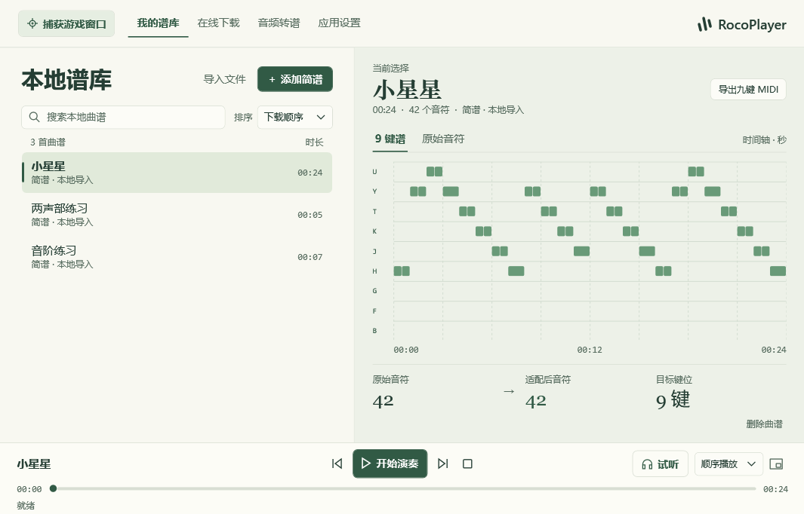
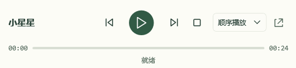

# RocoMusicPlayer

RocoMusicPlayer 是《洛克王国：世界》的九键乐器播放器。导入 MIDI 或简谱后，可以对照原谱和九键编配，用游戏实录的手碟音色试听，再在捕获的游戏窗口中演奏。

**[下载 Windows x64 安装包](https://github.com/Einzieg/RocoMusicPlayer/releases/latest/download/RocoMusicPlayer-win-x64-Setup.exe)** · [版本说明和 SHA-256](https://github.com/Einzieg/RocoMusicPlayer/releases/latest) · [使用指南](docs/guide.md)

## 免责声明

RocoMusicPlayer 是玩家独立维护的第三方工具，供曲谱编配、试听和演奏交流。软件按现状提供，担保与责任条款见项目许可。[MIT 许可](LICENSE)

自动演奏会向游戏发送模拟按键。请在启用前确认游戏规则允许此类操作。若被认定为违规，游戏运营方可能限制游戏功能或封停账号。[腾讯游戏许可及服务协议](https://game.qq.com/contract.shtml)



## 安装与升级

在 Windows 10 或 11 的 x64 系统运行安装包，按提示授予管理员权限，在「选择安装位置」页选择文件夹。安装完成后，可以从桌面的 **RocoMusicPlayer** 快捷方式或开始菜单的「RocoPlayer WPF」启动。安装包自带 .NET 桌面运行时、音频识别模型和 DD 63340 驱动。

| 安装前检测结果 | 安装程序的处理 |
| --- | --- |
| 已有正常的 DD 服务和设备 | 直接安装播放器，复用现有驱动。 |
| 未发现 DD 服务或关联设备 | 自动安装随包驱动，并检查设备是否启动成功。 |
| 已有驱动异常、上次安装待处理或无法确认状态 | 跳过驱动安装并提示诊断，播放器仍可使用。 |

升级前先退出播放器，安装向导会带出上次的安装位置。卸载默认保留谱库和设置，重装后可继续使用。若要清理，在卸载向导勾选「同时删除我的曲谱和设置」，并核对显示的目录。播放器会清理谱库、设置、在线下载、校准录音和个人运行日志，手动导入的原文件仍保存在原位置。[安装与诊断](docs/packaging.md)

## 演奏第一首曲子

1. 打开「我的谱库」，点击「导入文件」选择 MIDI 或 TXT，也可以点击「添加简谱」粘贴旋律。导入时会按 RocoMusic 工作台的规则自动适配九键。[小星星示例](docs/samples/twinkle.txt)
2. 选中曲目，在右侧切换「9 键谱」和「原始音符」，点击底栏「试听」听两种版本。拖动进度条可以定位，右上角可以导出九键 MIDI。
3. 在游戏里打开乐器。点击播放器左上角「捕获游戏窗口」，在三秒内切回游戏。按钮显示目标窗口名后，即可点击「开始演奏」，也可直接在游戏中按 **F8**。

| 快捷键 | 操作 |
| --- | --- |
| **F8** | 开始演奏当前曲目 |
| **F9** | 暂停或继续 |
| **F10** | 停止演奏或试听，释放演奏按键 |

失去游戏焦点时，播放器会暂停。置顶小窗支持切歌和停止，旁边的菜单可选择顺序播放、随机播放、单曲循环或列表循环。



## 谱库与音频转谱

- **我的谱库**支持按曲名或来源搜索，按下载顺序或名称排序。删除当前曲目后会选中列表里的相邻曲目。
- **在线下载**可以搜索 RocoMusic 谱库并保存 MIDI 原件。重复下载同一版本会复用已有记录。
- **音频转谱**支持最长五分钟的 WAV、MP3、FLAC 和 Ogg Vorbis。可选本地 Basic Pitch 模型、频谱主旋律或 YIN 单音识别，再试听并导出结果。

## 从源码运行

使用 Windows x64、PowerShell 7 和 .NET 8 SDK。在仓库根目录运行以下命令。

```powershell
$ErrorActionPreference = 'Stop'
dotnet run --project src/RocoPlayer -c Release
```

运行回归测试和构建安装包分别使用以下脚本。打包另需 NSIS 3 和 7-Zip。默认构建从固定的厂商版本取得 DD，校验签名和哈希，然后生成 `artifacts/RocoMusicPlayer-win-x64-Setup.exe` 和 `SHA256SUMS.txt`。[构建与发版](docs/packaging.md#github-actions-发版)

```powershell
$ErrorActionPreference = 'Stop'
./scripts/Test-RocoPlayer.ps1
./scripts/Build-Installer.ps1
```

播放器以 MIT 许可发布。DD、游戏实录音色、Basic Pitch 模型和其他第三方组件各自适用其原有条款。[项目许可](LICENSE) · [第三方组件说明](docs/THIRD_PARTY_NOTICES.md)
